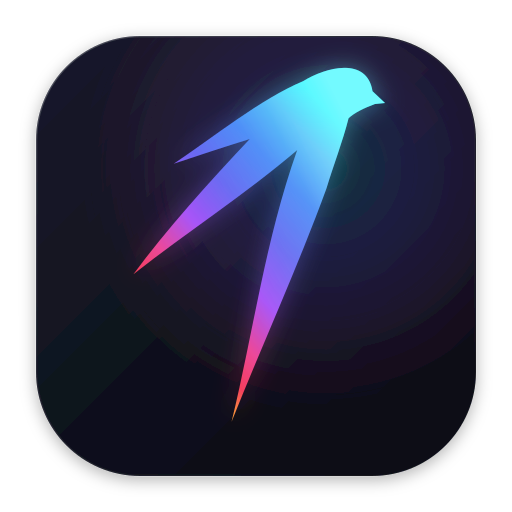
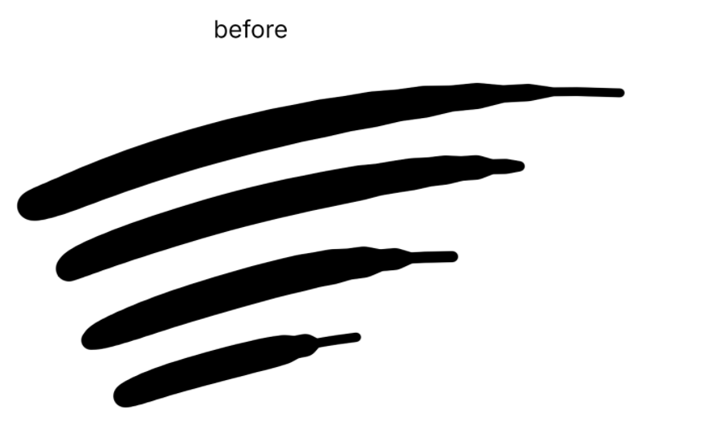
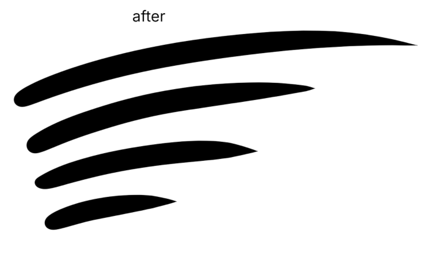

<div align="center">



# FlipCraft

**The high-performance, artist-centric digital painting & image editor written in pure Rust.**

[](https://github.com/Paxon123/FlipCraft/releases)
[](LICENSE-MIT)
[](https://www.rust-lang.org/)
[-success.svg)](#architecture)

</div>

---

## 🎨 Overview

**FlipCraft** is a modern, distraction-free digital painting and image editing application engineered for speed, brush responsiveness, and fluid stroke dynamics. Built natively in 100% safe, high-performance Rust (`egui`/`eframe` on `wgpu`), FlipCraft eliminates input lag, Dab starvation, and UI clutter to deliver an unmatched tactile drawing experience for professional artists, illustrators, and concept creators.

Whether executing rapid line-art crosshatching, razor-sharp calligraphy, or large-format textured blending, FlipCraft responds instantly to every stylus nuance.

---

## ⚡ Core Advantages

### 1. Adaptive Distance Stepping & Dynamic Spacing
Traditional digital painting engines suffer from **dab starvation**: when stylus pressure drops rapidly during quick flick strokes or line-art tapering, fixed distance accumulation skips segments, producing jagged, blunt cutoffs.

FlipCraft incorporates an **adaptive distance accumulator**:
- As stylus pressure falls and required dab spacing shrinks, the accumulator triggers dabs instantaneously ($t = 0.0$) rather than skipping forward.
- Ensures seamless, dense, and continuous stroke continuity during lightning-fast pen flicks.
- Eliminates polygon stair-stepping and empty gaps across rapid hand motions.

### 2. Catmull-Rom Bézier Interpolation & Needle-Sharp Tapering
- **Curvature Continuity**: Stylus pointer events are fitted with smooth cubic Bézier splines using Catmull-Rom velocity tangents, subdivided recursively with De Casteljau midpoints. Fast flicks follow clean, flowing curves rather than polyline line segments.
- **Tail Aggressiveness**: A specialized pen-lift convergence filter dynamically scales spatial filter weights as stylus pressure decreases ($dP/dt < 0$), pulling the stroke rapidly and precisely into the liftoff point. Every stroke resolves to a razor-sharp, needle-thin finish.

### 3. Native 16k & 8k Windows Ink Digitizer Pipeline
- Direct Win32 `WM_POINTER` integration bypassing legacy WinTab abstractions.
- Full hardware dynamic range utilization for **8,192** and **16,384** pressure-level digitizers (Wacom Pro Pen 2/3, Huion, XPPen, Surface Pen) with true linear tracking and zero premature saturation.
- Real-time hardware physical eraser tip flip detection, tilt X/Y ($-90^\circ \dots +90^\circ$), and barrel rotation ($0^\circ \dots 359^\circ$) without interference from synthetic touch gestures.
- Event compression and deduplication preventing 240Hz+ high-frequency digitizer packet flooding.

### 4. High-Performance GPU Compositing & Bounded Dab Caching
- **Thread-safe Dab Cache**: Pre-rendered floating-point coverage masks indexed by discretized radius, softness, and hardness.
- Avoids costly per-pixel radial equations on the CPU, blitting directly into tile buffers with SIMD/vectorized coverage blending.
- Rock-solid 60+ FPS responsiveness even on ultra-large brushes (up to 500px diameter).

### 5. Photoshop-Familiar, Clutter-Free Workflow
- Instant zero-latency startup without Electron, Chromium, or webview wrappers.
- Industry-standard Photoshop keybindings, menus, blending modes, and layer architecture.
- Clean studio interface focusing entirely on the canvas.

---

## 🔍 Brush Engine Comparison: Before vs. After

The difference between legacy linear stepping and FlipCraft's adaptive Catmull-Rom dynamics is immediately apparent on rapid strokes and flick tapering:

<div align="center">

### Before Overhaul (Linear Stepping / Dab Starvation)
*Notice the blunt stroke terminations, erratic thickness jumps, and polyline breaks on quick flicks:*



---

### After Overhaul (FlipCraft Adaptive Distance & Catmull-Rom Bézier Splines)
*Notice the needle-sharp stroke tapering, continuous curvature, and fluid thickness transitions:*



</div>

---

## 💖 Sponsorship & Priority Feature Requests

FlipCraft is independent open-source software funded by artists and creators. Donations directly fund dedicated GPU compute instances for AI tool research, hardware tablet digitizer testing, and core engine performance optimization.

### Cryptocurrency Donation Channels

* **USDT (TRC-20 / Tron Network)**:
  ```text
  TFYNjg8Uob2mz84Q1yAV2RpHkhjJXafGq5
  ```

* **USDT (BEP-20 / BNB Chain)**:
  ```text
  0x9428E0499C830A2d26A4A229Bc5b6e88184Fa960
  ```

> **Sponsorship Disclaimer**:  
> *Donations fund AI compute and ongoing development. Sponsored requests receive top priority in development queues while maintaining FlipCraft's vision and quality bar.*

### Submit a Priority Feature Request

If you have contributed via the sponsorship channels above, submit your feature proposal using our dedicated template:
👉 **[Submit a Priority Feature Request](.github/ISSUE_TEMPLATE/priority_request.yml)**

Include your transaction hash (TxID) to link your submission directly to the priority sponsor development backlog.

---

## 🚀 Building & Running from Source

### Prerequisites
- **Rust Toolchain**: Rust 1.95 or newer (Edition 2024).
- **C Compiler**: MSVC (Windows), GCC/Clang (Linux/macOS).
- On Linux, install development headers:
  ```bash
  sudo apt-get install libxkbcommon-dev libwayland-dev libx11-dev libxrandr-dev libxi-dev libgl1-mesa-dev
  ```

### Build & Launch Desktop Application
```bash
# Clone the repository
git clone https://github.com/Paxon123/FlipCraft.git
cd FlipCraft

# Run FlipCraft in release mode
cargo run -p flipcraft --release
```

### Run Automated Test Suite
```bash
# Run all paint engine unit and integration tests
cargo test -p photocraft-paint

# Run full workspace checks
cargo check --workspace
```

---

## 📄 License & Upstream Attribution

FlipCraft is distributed under the dual **MIT License** and **Apache License, Version 2.0**. You may choose either license at your option. See [LICENSE-MIT](LICENSE-MIT) and [LICENSE-APACHE](LICENSE-APACHE) for details.

### Upstream Attribution
FlipCraft is an independent, artist-focused fork of [**PhotoCraft**](https://github.com/storytold/photocraft), created by the ArtCraft Team and contributors. FlipCraft is released under the same dual MIT / Apache-2.0 open-source licenses. We gratefully acknowledge the PhotoCraft authors for establishing a pure-Rust imaging foundation. Full per-file third-party credits and licenses are cataloged in [ATTRIBUTION.md](ATTRIBUTION.md) and [NOTICE](NOTICE).
